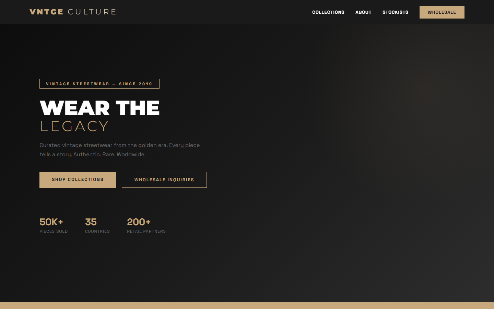
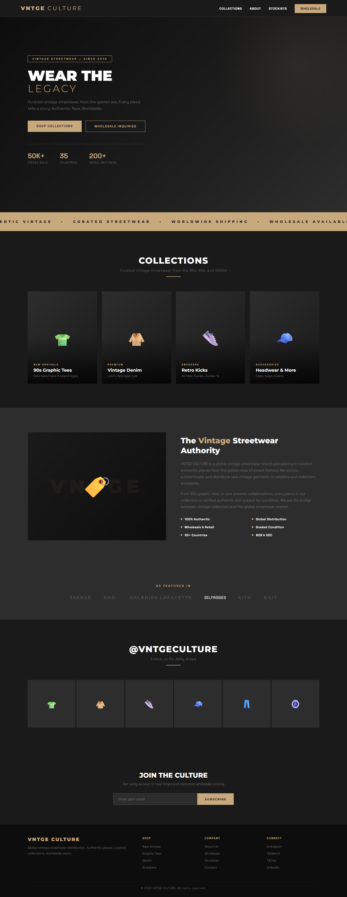
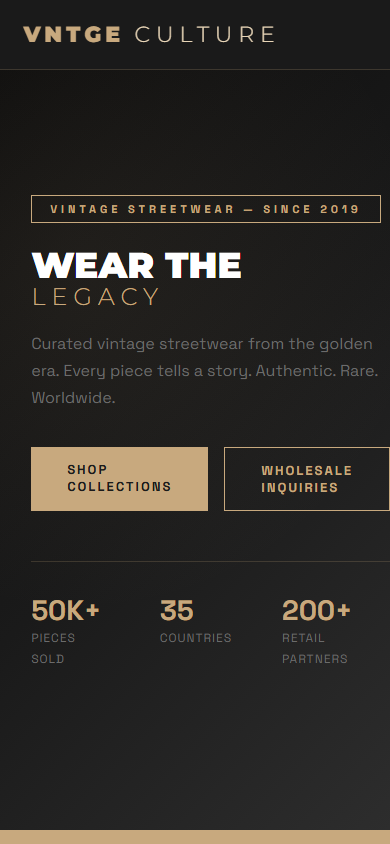

# VNTGE CULTURE — Brand Identity + Website Build


> **Concept project — read the status before the screenshots.**
> VNTGE CULTURE is a **brand and website build**: identity, design system, static site and the
> document tooling behind it. The venture is **pre-launch**, so the copy inside the site
> (the `50K+ / 35 / 200+` figures, the "As Featured In" retailer names, the `SINCE 2019`
> line) is **illustrative placeholder copy for the mockup** — not sales results and not
> real partnerships. The *design system and build* are the deliverable; the numbers are props.

---

## Portfolio showcase

**Desktop — first fold**



**Full page**



**Mobile — 390 px**



Real captures of the build, taken from the served site (zero console errors at 1440×900 and
390×844).

---

## The design system

Everything in the site comes from seven tokens and two typefaces — no framework, no build
step, no utility soup. The whole brand can be re-skinned from the `:root` block.

| Token | Value | Role |
|---|---|---|
| `--black` | `#1A1A1A` | Page ground — warm black, not pure `#000` |
| `--dark` | `#2D2D2D` | Panel / card elevation |
| `--gold` | `#C8A97E` | Primary accent — logo, CTAs, rules |
| `--gold-light` | `#E8D5B7` | Accent tint — nav wordmark, hover states |
| `--cream` | `#F5F0E8` | Warm neutral for large display text |
| `--white` | `#FFFFFF` | Body copy |
| `--gray` | `#6B6B6B` | Secondary copy, footer meta |

**Typography** — two families, split by job:

- **Montserrat** (300–900) for the brand voice: wordmark, display headlines, section titles.
  Heavy weights carry the vintage-archive feel; the tight letter-spacing on the wordmark
  (`VNTGE CULTURE`) is the identity's signature.
- **Space Grotesk** (400–700) for reading: body copy, navigation, labels. Its squarish
  terminals echo industrial clothing tags without fighting Montserrat for attention.

**Structure** — six movements, one story: `hero → marquee → collections → about → stockists →
social → newsletter → footer`, with a fixed translucent nav that picks up a hairline gold
border on scroll.

**Signature moments**

1. The gold **hairline rule + tracking-wide kicker** (`VINTAGE STREETWEAR — SINCE 2019`)
   that frames the hero — it sets the archival tone before a word is read.
2. The **marquee strip** between hero and collections (`AUTHENTIC VINTAGE · CURATED
   STREETWEAR · WORLDWIDE SHIPPING · WHOLESALE AVAILABLE`) — the wholesale promise stated
   as a rhythm, not a paragraph.
3. Product category tiles with **CSS-drawn garment glyphs** (tee, denim, kicks, headwear) —
   the site ships without a single raster image, so it stays sharp and weighs nothing.

---

## Repository layout

```text
brand/
  logo.svg            wordmark + mark (scalable, single file)
website/
  index.html          the full site — markup, design system, behaviour
docs/
  preview-desktop.png real capture, 1440×900
  preview-full.png    real capture, full page
  preview-mobile.png  real capture, 390×844
```

**Kept local on purpose** (excluded via `.gitignore`, never pushed): the company profile PDF,
the analytics dashboard XLSX, the pitch deck PPTX, email templates, and the launch plan —
built by `documents/build_streetwear.py` (`openpyxl` + `python-pptx` + `reportlab`).
Business material does not belong in a public repository; the tooling does.

---

## The build pipeline behind the brand

The brand is one half of a reusable pattern I use for venture builds:

| Stage | Output | Tooling |
|---|---|---|
| Identity | Logo, palette, type, voice | SVG + token block |
| Website | Responsive static site | Single-file HTML/CSS/JS |
| Office material | Company profile, dashboard, deck | `build_streetwear.py` (openpyxl / python-pptx / reportlab) |
| Templates | Email signatures, outreach | Local HTML templates |

The same pipeline produced the Quality House agricultural-export package — the point of the
pattern is that a venture's brand, site and collateral stay consistent because they are
generated from one token set, not re-typed per artefact.

---

## Status — honest labels

**Concept / prototype.** The brand system and site build are complete and responsive; the
venture behind it has not launched. Placeholder marketing copy remains in the site and must be
replaced with real figures and real partners before any commercial use.

## Licence

MIT — see [`LICENSE`](LICENSE).
